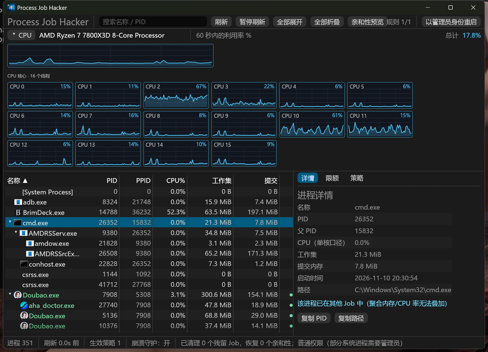
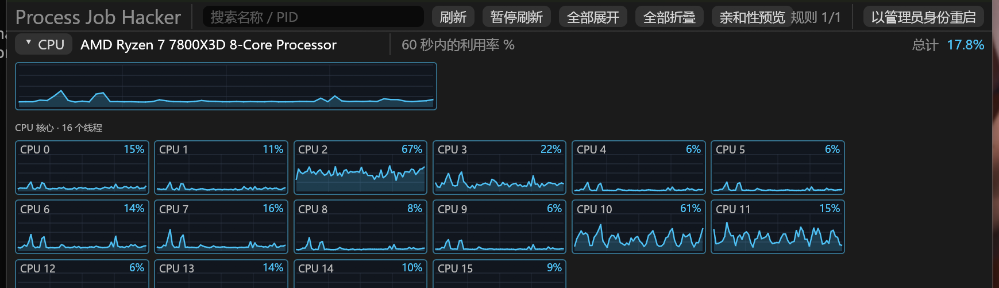
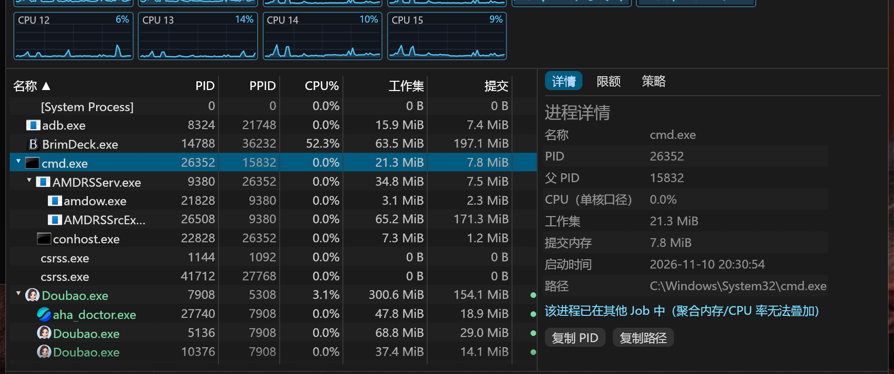
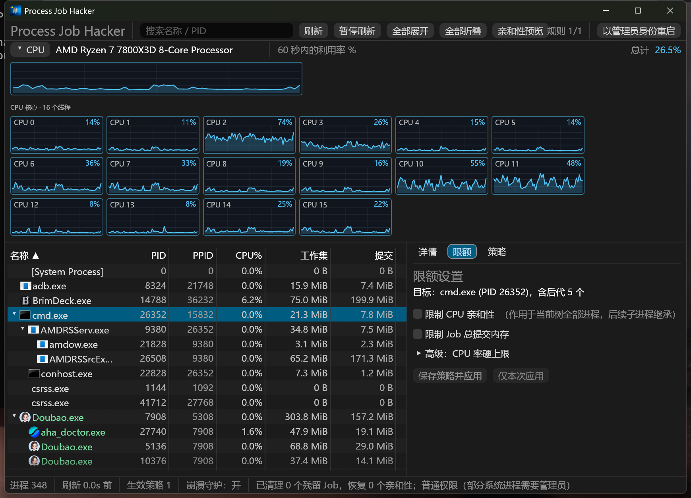
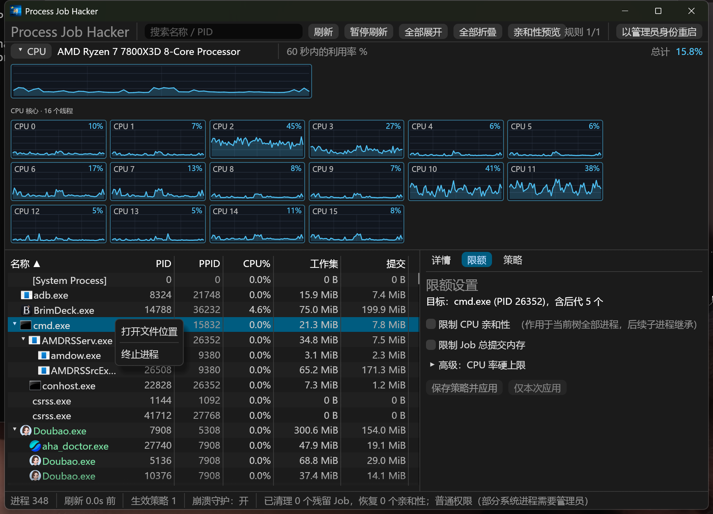
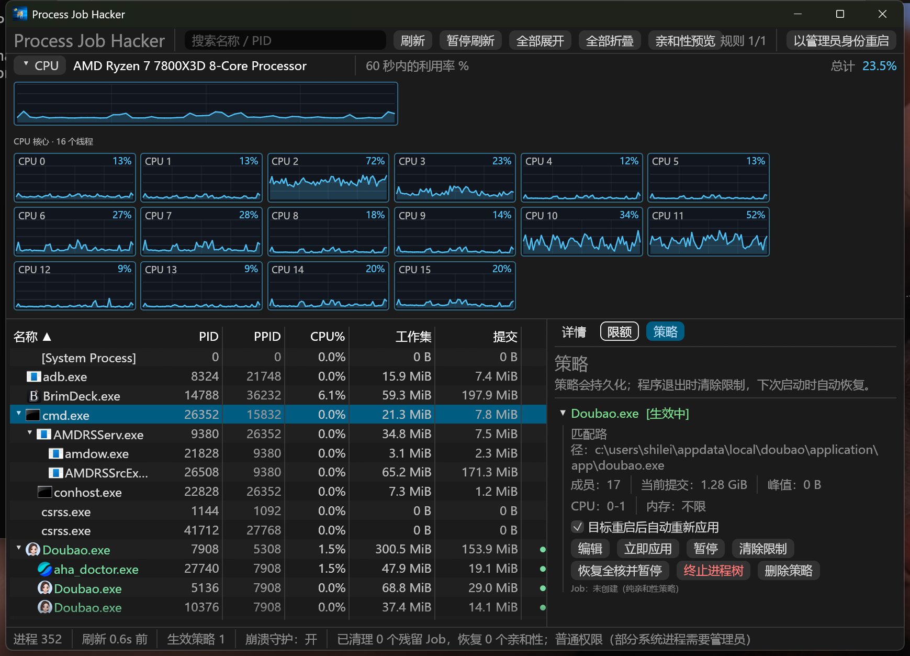

<p align="center">
  
</p>

<h1 align="center">Process Job Hacker</h1>

<p align="center">
  Pin process trees to the CPU cores you want, cap their Job commit memory, and keep those limits across restarts — without fighting Windows Job Objects by hand.
  <br>
  A native Windows desktop app built with Rust and egui.
</p>

<p align="center">
  <a href="https://github.com/prostones/Process-Job-Hacker/releases/latest"></a>
  <a href="https://github.com/prostones/Process-Job-Hacker/releases/latest"></a>
  <a href="LICENSE"></a>
  
</p>

<p align="center">
  <a href="#why-process-job-hacker">Why</a> ·
  <a href="#features">Features</a> ·
  <a href="#install">Install</a> ·
  <a href="#quick-start">Quick start</a> ·
  <a href="#faq">FAQ</a> ·
  <a href="#build">Build</a> ·
  <a href="README.zh-CN.md">简体中文</a>
</p>

<p align="center">
  
</p>

## Why Process Job Hacker

- **Stop runaway trees, not just one PID**: Limits apply to a process and its descendants as a group — the usual shape of browsers, Electron apps, and game launchers.
- **Affinity that survives nested Jobs**: Pure CPU-affinity policies never create a Job, so Chrome / Doubao-style processes that already live in their own Job can still be pinned to the cores you choose.
- **Hybrid CPU awareness**: On Intel P/E systems the charts split Performance and Efficient cores; one-click actions can pin a tree to P0 (first physical core) or to all P-cores only.
- **Persistent policies**: Match by executable path, re-apply when the target restarts, clear limits on a clean exit, and restore them on the next launch.
- **Crash-safe cleanup**: A small `--guard` helper watches the UI process and tears down Jobs / restores affinity if the main window dies.
- **Live CPU view**: Per-logical-core history for the last 60 seconds, plus a searchable process tree with icons, sorting, and rule coloring.

## Features

### CPU monitor



- Total utilization plus a sparkline per logical processor (last 60 seconds).
- Hybrid layouts show P-cores and E-cores in separate groups when Windows reports an efficiency split.
- Hover a chart for the exact percentage; high load points are tinted for quick scanning.

### Process tree



- Columns: name (with icon), PID, PPID, CPU%, working set, commit, and active rule.
- Indentation follows the parent/child tree; numeric columns stay right-aligned.
- Search by name or PID; expand / collapse / pause refresh from the toolbar.
- Click a row to inspect details on the right — path, start time, and Job membership notes.

### One-click and custom limits



- **Limits** tab: toggle CPU affinity (mask editor + core shortcuts), Job commit-memory cap, and an optional CPU-rate hard ceiling.
- Save as a persistent policy or apply once for the current session.
- On hybrid CPUs, the row context menu can pin the whole tree to **P0** or **all P-cores** and write the policy immediately.



- Processes already inside another Job fall back to affinity-only; the UI summarizes that instead of spamming per-PID errors.

### Persistent policies



- Each policy card shows match path, affinity / memory / rate, and whether it is active.
- Pause, resume, edit, delete, or “restore all cores and pause” when an old pin needs clearing.
- Closing the window hides to the tray — limits keep working. Exit from the tray to clear limits and keep the config for next time.

### Tray and lifecycle

- Tray: show/hide, pause all, resume all, clear all limits, quit (clears limits).
- Normal quit restores affinity and tears down Jobs; crash guard covers abnormal exits.
- Startup cleans leftover Jobs/affinity from a previous run, then reapplies enabled policies.

## Install

Requires **Windows 10 1809+** (build 17763) or newer, **x64 only**. Administrator rights are required to open other processes for affinity and Job Object APIs.

1. Download from [Releases](https://github.com/prostones/Process-Job-Hacker/releases/latest):
   - Installer: `ProcessJobHacker-<version>-Setup.exe`
   - Portable: `ProcessJobHacker-<version>-win-x64.zip` — extract and run `process-job-hacker.exe`
2. If SmartScreen warns about an unknown publisher, choose **More info** → **Run anyway** (release builds are unsigned by default).

Per-user installs land under `%LOCALAPPDATA%\Programs\Process Job Hacker`. Config and logs stay under `%APPDATA%\prostones\ProcessJobHacker` and `%LOCALAPPDATA%\prostones\ProcessJobHacker`.

## Quick start

1. Launch the app (accept the UAC prompt on release builds).
2. Find a process in the tree (search helps) and select its root.
3. Open **Limits**, set affinity and/or memory (and optional CPU rate), then **Save policy and apply** — or use a one-click pin from the context menu on hybrid CPUs.
4. Confirm the rule color on the tree and the card under **Policies**.
5. Close the window to keep limiting in the background; use the tray **Quit (clear limits)** when you are done.

## Uninstall

- Installer: remove **Process Job Hacker** from Windows Settings → Apps.
- Portable: quit from the tray, then delete the folder.

To remove settings and logs as well, delete:

- `%APPDATA%\prostones\ProcessJobHacker`
- `%LOCALAPPDATA%\prostones\ProcessJobHacker`

## FAQ

**Why can I only change affinity on Chrome / some Electron apps?**  
Those processes already belong to a non-empty Job. Windows will not let a second non-empty Job claim them. Affinity still applies process-by-process; memory and CPU-rate Job limits cannot stack.

**Is the memory limit working set or commit?**  
It is **Job commit memory** (`JOB_OBJECT_LIMIT_JOB_MEMORY`). Hitting the cap fails allocations and can crash the target if it is not prepared for that.

**Closing the window did not stop the limits.**  
Closing hides to the tray on purpose. Quit from the tray menu to clear limits.

**Debug build cannot touch elevated processes.**  
Debug uses `asInvoker`. Use **Restart as administrator** in the UI, or run a release build (requires elevation via manifest).

**Where is the config?**  

- Config: `%APPDATA%\prostones\ProcessJobHacker\config\config.json`
- Active-job journal: `%LOCALAPPDATA%\prostones\ProcessJobHacker\data\active_jobs.json`
- Logs: `%LOCALAPPDATA%\prostones\ProcessJobHacker\data\logs\`

**Useful CLI flags**

```powershell
process-job-hacker.exe --safe-mode          # UI without auto-applying policies
process-job-hacker.exe --clear-persisted    # clear leftover limits, then exit
process-job-hacker.exe --quit-running       # ask the running instance to quit cleanly
```

## Build

```powershell
rustup toolchain install stable-x86_64-pc-windows-msvc
rustup default stable-x86_64-pc-windows-msvc   # or: rustup override set stable-x86_64-pc-windows-msvc
cargo build --release --target x86_64-pc-windows-msvc
```

Ship a release package (fmt, clippy, tests, static CRT, ZIP, Inno Setup):

```powershell
powershell -NoProfile -ExecutionPolicy Bypass -File .\scripts\package.ps1
```

Artifacts appear under `dist\`. Optional `-SkipTests` / `-SkipInstaller` / `-DynamicCrt` flags are documented in the script header.

## License

[MIT](LICENSE)
