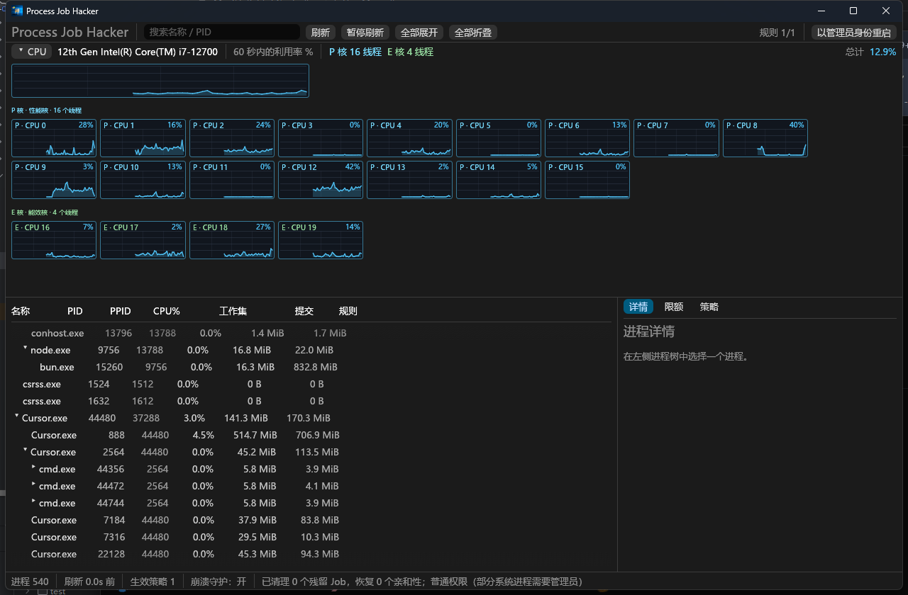

# Process Job Hacker

基于 Rust + eframe/egui + Windows Job Object 的进程树 CPU / 内存限额工具。

## 界面截图



## 功能

- 顶部 CPU 面板：
  - 自动识别 Intel P 核 / E 核（`GetLogicalProcessorInformationEx` + `EfficiencyClass`）。
  - P 核与 E 核折线图分组显示，E 核单独起一行。
  - P 核与总 CPU 默认淡蓝；E 核默认绿色；单点 >80% 黄色，>95% 红色。
  - 总 CPU 图 + 60 秒每核历史 + 悬停 tooltip。
- 进程树：
  - 名称、PID、PPID、CPU%、工作集、提交内存、规则状态。
  - 名称列左对齐并按层级向右缩进；数值列表头/数据统一右对齐。
  - 右键“一键限制到 P0（CPU 0-1，持久化）”：对当前树全部进程设置 P0 物理核亲和性，子进程继承；已有策略则保留其内存/CPU 率并更新亲和性，无策略时创建持久策略；每次都会写入 `config.json`。纯亲和性策略不创建 Job，Doubao/Chrome 等自带 Job 的进程也能直接应用。
  - 右键“一键限制到 全部 P 核（CPU 0-15，持久化）”：把当前树全部进程及其后代绑定到所有 P 核逻辑 CPU，调度器不会再把这些进程放到 E 核；仅在混合架构（同时存在 P/E 核）时显示，行为与 P0 快捷项一致，会持久化并自动重新应用。
  - 搜索、展开/折叠、刷新暂停。
- 限额：
  - CPU 亲和性：直接对树内进程 `SetProcessAffinityMask`，子进程继承父进程亲和性。
  - 内存：Job Object `JOB_OBJECT_LIMIT_JOB_MEMORY`，限制父节点 + 全部后代的 Job 总提交内存。
  - 可选 CPU 率硬上限（`JobObjectCpuRateControlInformation`）。
  - 纯亲和性策略不创建 Job；只有内存/CPU 率才需要 Job。
  - 目标已在自身 Job 中时，Windows 只允许空 Job 接收；无法叠加的进程会降级为仅亲和性并汇总提示，不再逐条报错。
- 持久策略：
  - 按 exe 路径匹配目标；目标重启时自动重新应用。
  - 程序退出后清除限制，配置保留；下次启动自动恢复。
  - 策略卡片“恢复全核并暂停”：把覆盖进程强制设回全核并暂停策略，用于旧版本残留或外部手工固定。
- 生命周期：
  - 关闭窗口 = 隐藏到托盘，限制继续生效。
  - 正常退出 = 清除限额 + 恢复应用前亲和性 + 保留配置。
  - 崩溃守护：`--guard` 进程等待主程序退出，清理 Job 并恢复亲和性。
  - 启动前清理上次残留，再恢复策略。
- 托盘：显示/隐藏、暂停全部、恢复全部、解除全部限制、退出（清除限制）。
- 安全模式与恢复：`--safe-mode`、`--clear-persisted`。

## 图标资源

- `assets/hero-original.jpg`：原图
- `assets/icon.png`：1024×1024 程序/窗口图标
- `assets/tray-icon.png`：256×256 托盘图标
- `assets/app.ico`：16/24/32/48/64/128/256 多尺寸 exe 图标

## 系统要求

- Windows 10 1809（build 17763）或更高版本，仅 x64。
- 程序运行需要管理员权限：CPU 亲和性和 Job Object 操作需要打开其他进程。
- 默认发布包使用静态 CRT，不需要安装 Rust、.NET 或 Visual C++ 运行库。

## 构建

开发构建：

```powershell
rustup update stable   # 需要 rustc >= 1.95
cargo build --release
```

release 构建通过 manifest 请求管理员权限；debug 构建为 `asInvoker`，可在界面点击“以管理员身份重启”。

## 分发打包

```powershell
# 检查、静态 CRT 构建、便携 ZIP、SHA256 和 Inno Setup 安装包
powershell -NoProfile -ExecutionPolicy Bypass -File .\scripts\package.ps1

# 只做便携 ZIP
powershell -NoProfile -ExecutionPolicy Bypass -File .\scripts\package.ps1 -SkipInstaller

# 跳过 fmt/clippy/test，快速本地出包
powershell -NoProfile -ExecutionPolicy Bypass -File .\scripts\package.ps1 -SkipTests
```

产物：

```text
dist\
  ProcessJobHacker-0.1.0-win-x64\
    process-job-hacker.exe
    README.md
    LICENSE
    CHANGELOG.md
    SHA256SUMS.txt
    assets\main-window.png
  ProcessJobHacker-0.1.0-win-x64.zip
  ProcessJobHacker-0.1.0-win-x64.zip.sha256
  ProcessJobHacker-0.1.0-Setup.exe
  ProcessJobHacker-0.1.0-Setup.exe.sha256
  SHA256SUMS.txt
```

- 安装包由 `installer/process-job-hacker.iss` 生成，Inno Setup 7.1.0 通过 `installer/InnoSetup.csproj` 从 NuGet 还原，不要求本机预装。
- 默认按当前用户安装到 `%LOCALAPPDATA%\Programs\Process Job Hacker`，安装和升级不弹 UAC；首次启动程序仍会请求管理员权限。安装器第一个对话框也可以选择“为所有用户安装”。
- 安装完成页勾选“启动”时会通过 `runas` 触发 UAC；取消 UAC 不会影响安装结果，可以从开始菜单启动。
- 安装包会先尝试让正在运行的程序自动退出：新版通过退出事件（等价于 `--quit-running`）清理后退出，旧版或卡死时只结束主窗口和预览进程并保留 guard 清理；回退强杀需要提权时可能弹一次 UAC。
- 升级时安装器会先静默卸载旧版本，再安装新版本；配置、日志和活动 Job 记录默认保留。卸载时可选择是否同时删除这些数据。
- 便携包解压后直接运行；从网络下载的 ZIP 可能被标记为“来自 Internet”，可右键属性解除锁定，或执行 `Unblock-File`。
- 发布包默认未签名，Windows SmartScreen 可能提示“未知发布者”。如使用代码签名证书，可传 `-PfxPath` 和 `-PfxPassword`，或设置 `PJH_PFX_PASSWORD` 环境变量。
- 若静态 CRT 在 wgpu/eframe 链接阶段失败，可加 `-DynamicCrt` 改用动态 CRT；此时目标机需要安装 Microsoft Visual C++ 2015-2022 x64 Redistributable。

## 使用

1. 启动程序，选择目标进程。
2. 在右侧“限额”页勾选 CPU 亲和性、内存上限、可选 CPU 率。
3. 点击“保存策略并应用”持久化；或“仅本次应用”创建临时规则。
4. 关闭窗口只是隐藏到托盘；托盘菜单“退出（清除限制）”才真正退出。
5. 退出后配置保留；再次启动时自动重新匹配并应用。

## 生命周期

```text
应用策略:
  纯亲和性:
    逐进程 SetProcessAffinityMask
      -> 写入 active_jobs.json（不创建 Job）
  内存 / CPU 率:
    创建/打开 Job
      -> 先根进程、后当前后代加入 Job
      -> 逐进程 SetProcessAffinityMask
      -> 已在其他 Job 中的进程降级为仅亲和性
      -> 写入 active_jobs.json

正常退出:
  清 Job 限额 -> 恢复原始亲和性（含仅亲和性进程）-> 清空 journal -> 退出

崩溃:
  guard 检测父进程退出
    -> 打开 journal 中的 Job 并清理
    -> Job 已销毁时按 PID + start_time 恢复亲和性
    -> 清空 journal

重启:
  等待/终止残留 guard
    -> 清理残留 Job / 亲和性
    -> 启动新 guard
    -> 匹配当前进程并恢复策略
```

## 配置位置

- 配置：`%APPDATA%\prostones\ProcessJobHacker\config\config.json`
- 活动 Job 日志：`%LOCALAPPDATA%\prostones\ProcessJobHacker\data\active_jobs.json`
- 日志：`%LOCALAPPDATA%\prostones\ProcessJobHacker\data\logs\`

## 命令行

```powershell
process-job-hacker.exe --clear-persisted   # 清理崩溃残留的限制并退出
process-job-hacker.exe --safe-mode         # 启动 UI，但不自动应用策略
process-job-hacker.exe --quit-running      # 通知正在运行的实例清理后退出
process-job-hacker.exe --sankey-preview <svg路径>  # 打开独立预览窗口
process-job-hacker.exe --guard --parent-pid <pid> --journal <path>
```

## 已知限制

- 已在其他 Job 中的进程：Windows 要求接收方 Job 为空（或与目标处于同一嵌套层级）。本工具先加入其他进程后 Job 已非空，因此这类进程只能应用 CPU 亲和性，聚合内存/CPU 率不会生效；界面会汇总提示，而不是逐条报错。
- 受保护进程（PPL 等）仍可能无法打开。
- Job 内存上限是**提交内存**上限，不是工作集上限；超限表现为分配失败，可能导致目标崩溃。
- CPU 亲和性为逐进程设置；若目标进程自己修改亲和性，本工具不会持续强制纠正。
- 旧版本可能把 P0 掩码误记为“原始亲和性”。策略卡片的“恢复全核并暂停”可强制把覆盖进程设回全核，并暂停策略。
- 由 WMI `Win32_Process.Create` 创建的进程不会继承 Job。
- 系统存在多个处理器组（>64 逻辑核）时，亲和性仅支持组 0。
- 主程序和 guard 同时被杀死时，旧限制可能残留到下次启动清理。
- 不设置 `JOB_OBJECT_LIMIT_KILL_ON_JOB_CLOSE`，退出不会终止目标进程。
- 发布包默认未签名，Windows SmartScreen 可能拦截首次运行。
- 安装包默认按当前用户安装，但程序启动仍会请求管理员权限。

## 测试

```powershell
cargo fmt --check
cargo clippy --all-targets -- -D warnings
cargo test
```

分发前再执行一次完整出包：

```powershell
powershell -NoProfile -ExecutionPolicy Bypass -File .\scripts\package.ps1
```

集成测试会启动 `cmd.exe /C ping`，验证 Job 分配、CPU 亲和性、限额清理与 journal 恢复。
