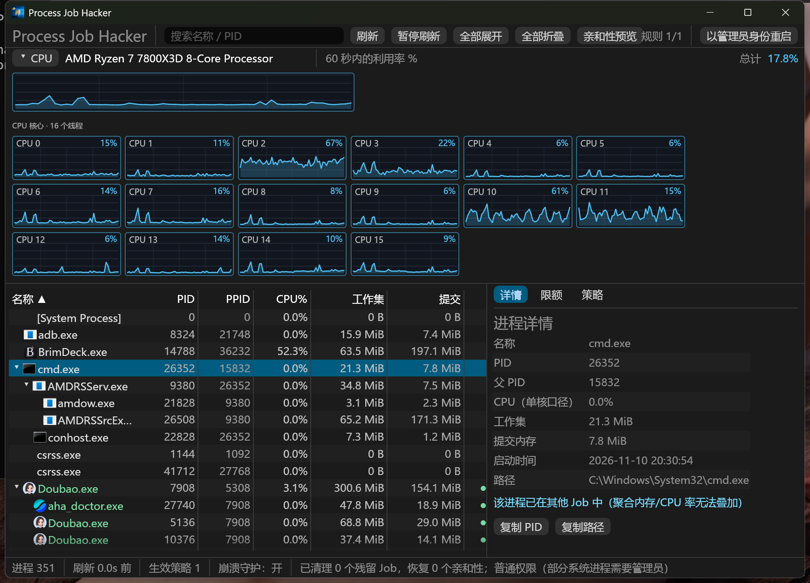
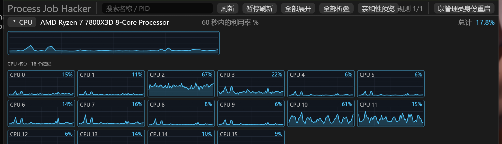
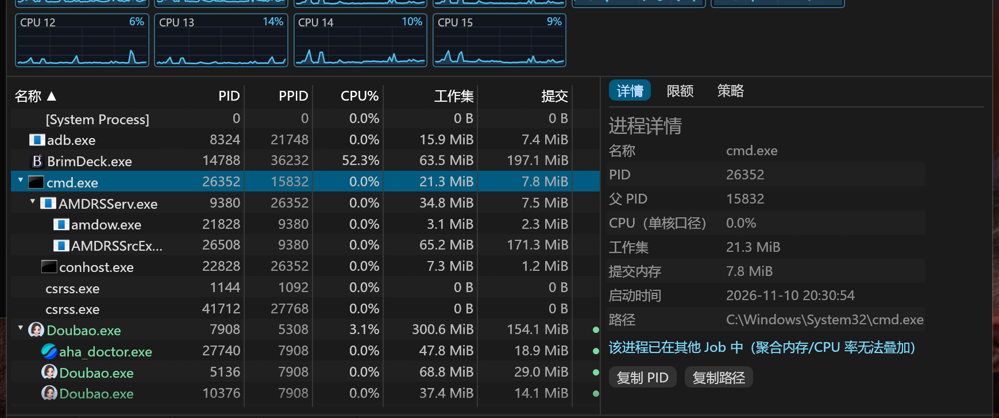
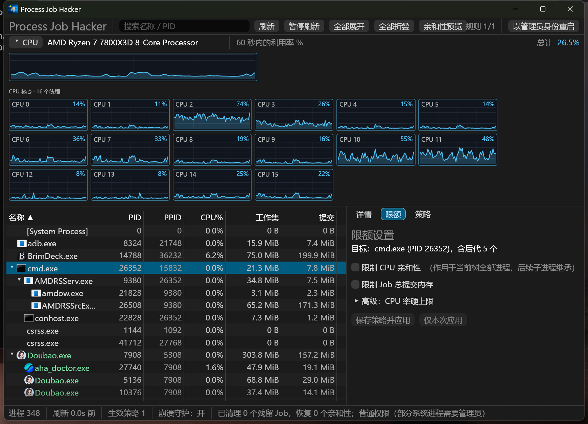
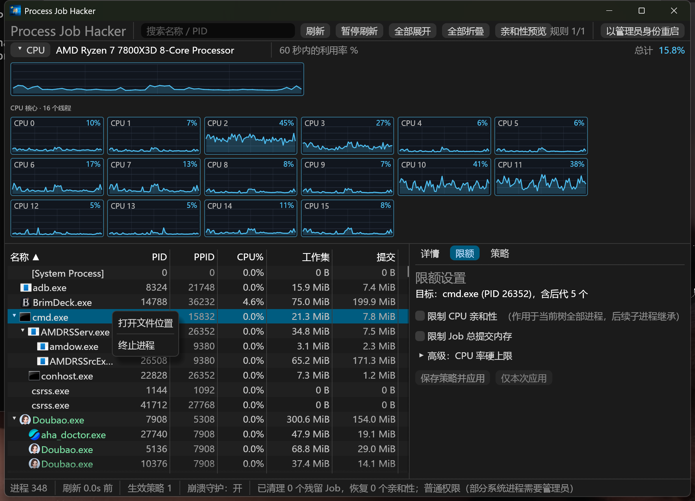
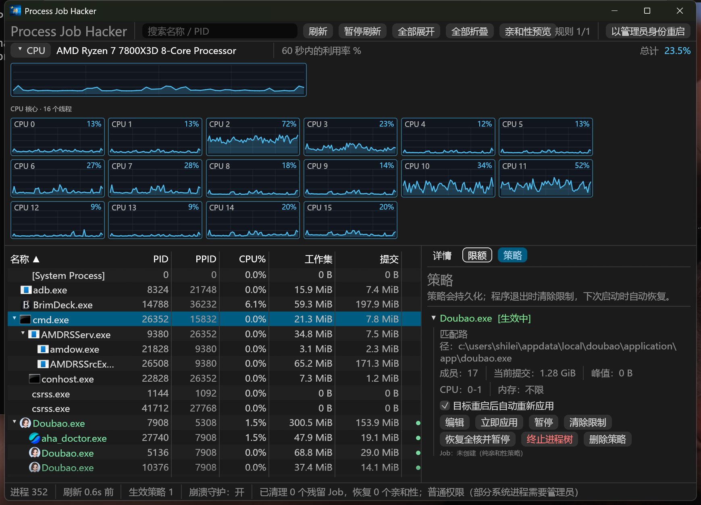

<p align="center">
  
</p>

<h1 align="center">Process Job Hacker</h1>

<p align="center">
  把进程树钉在你指定的 CPU 核心上，限制 Job 提交内存，并在目标重启后自动恢复 —— 不必手工折腾 Windows Job Object。
  <br>
  Windows 原生桌面应用，使用 Rust 与 egui 开发。
</p>

<p align="center">
  <a href="https://github.com/prostones/win-job-limiter/releases/latest"></a>
  <a href="https://github.com/prostones/win-job-limiter/releases/latest"></a>
  <a href="LICENSE"></a>
  
</p>

<p align="center">
  <a href="#为什么选择-process-job-hacker">为什么</a> ·
  <a href="#功能">功能</a> ·
  <a href="#安装">安装</a> ·
  <a href="#快速开始">快速开始</a> ·
  <a href="#常见问题">常见问题</a> ·
  <a href="#构建">构建</a> ·
  <a href="README.md">English</a>
</p>

<p align="center">
  
</p>

## 为什么选择 Process Job Hacker

- **限制整棵进程树，而不只是一个 PID**：浏览器、Electron、游戏启动器这类父子成群的目标，按树统一施加限制。
- **亲和性也能对付「已在 Job 里」的进程**：纯 CPU 亲和性策略不创建 Job，Chrome / 豆包等自带 Job 的进程仍可被钉到指定核心。
- **混合架构友好**：Intel P/E 核会在图表中分组显示；一键操作可把树钉到 P0（第一颗物理核）或「仅全部 P 核」。
- **持久策略**：按 exe 路径匹配，目标重启后自动再应用；正常退出时清除限制，下次启动再恢复。
- **崩溃也可清理**：`--guard` 守护进程监视主界面，异常退出时拆除 Job 并恢复亲和性。
- **实时 CPU 视图**：每逻辑核最近 60 秒历史，可搜索的进程树（图标、排序、规则着色）。

## 功能

### CPU 监控



- 总利用率 + 每个逻辑处理器的折线图（最近 60 秒）。
- 若 Windows 报告能效分级，P 核与 E 核分组显示。
- 悬停可看精确百分比；高负载点会变色提示。

### 进程树



- 列：名称（含图标）、PID、PPID、CPU%、工作集、提交内存、规则状态。
- 按父子层级缩进；数值列右对齐。
- 可按名称 / PID 搜索；工具栏支持展开、折叠、暂停刷新。
- 单击一行在右侧查看详情：路径、启动时间、是否已在其他 Job 中等。

### 一键限制与自定义限额



- **限额**页：开关 CPU 亲和性（掩码编辑 + 核心快捷项）、Job 提交内存上限、可选 CPU 率硬上限。
- 可「保存策略并应用」，或「仅本次应用」。
- 在混合架构 CPU 上，行右键菜单可把整棵树一键钉到 **P0** 或 **全部 P 核**，并立即写入策略。



- 已在其他 Job 中的进程会降级为仅亲和性；界面汇总提示，而不是逐 PID 报错。

### 持久策略



- 策略卡片显示匹配路径、亲和性 / 内存 / 速率，以及是否生效。
- 支持暂停、恢复、编辑、删除，以及「恢复全核并暂停」（清理旧版错误钉核）。
- 关闭窗口 = 隐藏到托盘，限制继续生效；从托盘退出才会清除限制并保留配置。

### 托盘与生命周期

- 托盘：显示/隐藏、暂停全部、恢复全部、解除全部限制、退出（清除限制）。
- 正常退出会恢复亲和性并拆除 Job；崩溃由 guard 兜底清理。
- 启动时先清理上次残留，再按启用策略重新匹配并应用。

## 安装

需要 **Windows 10 1809+**（build 17763）或更高版本，**仅 x64**。对其他进程设置亲和性与 Job Object 需要**管理员权限**。

1. 从 [Releases](https://github.com/prostones/win-job-limiter/releases/latest) 下载：
   - 安装包：`ProcessJobHacker-<version>-Setup.exe`
   - 便携包：`ProcessJobHacker-<version>-win-x64.zip`，解压后运行 `process-job-hacker.exe`
2. 若 SmartScreen 提示未知发布者，选择 **更多信息** → **仍要运行**（默认发布包未签名）。

当前用户安装目录为 `%LOCALAPPDATA%\Programs\Process Job Hacker`。配置与日志分别在 `%APPDATA%\prostones\ProcessJobHacker` 与 `%LOCALAPPDATA%\prostones\ProcessJobHacker`。

## 快速开始

1. 启动程序（正式版会弹出 UAC）。
2. 在进程树中找到目标根进程（可用搜索）。
3. 打开 **限额**，设置亲和性与/或内存（可选 CPU 率），点击 **保存策略并应用**；在混合架构上也可使用右键一键钉核。
4. 在树中确认规则着色，并在 **策略** 页查看卡片。
5. 关闭窗口即可后台继续限制；完成后从托盘选择 **退出（清除限制）**。

## 卸载

- 安装版：在 Windows 设置 → 应用 中卸载 Process Job Hacker。
- 便携版：先从托盘退出，再删除文件夹。

若要同时删除配置与日志，再删除：

- `%APPDATA%\prostones\ProcessJobHacker`
- `%LOCALAPPDATA%\prostones\ProcessJobHacker`

## 常见问题

**为什么 Chrome / 部分 Electron 应用只能改亲和性？**  
它们已经在非空 Job 中。Windows 不允许另一个非空 Job 再接收它们。亲和性仍可按进程设置；内存与 CPU 率的 Job 限额无法叠加。

**内存上限是工作集还是提交内存？**  
是 **Job 提交内存**（`JOB_OBJECT_LIMIT_JOB_MEMORY`）。触顶后分配会失败，目标若未处理可能导致崩溃。

**关掉窗口后限制还在？**  
关闭窗口会隐藏到托盘，这是预期行为。要从托盘菜单退出才会清除限制。

**Debug 构建碰不到提权进程？**  
Debug 使用 `asInvoker`。可在界面点 **以管理员身份重启**，或直接运行正式版（manifest 会请求提权）。

**配置在哪里？**  

- 配置：`%APPDATA%\prostones\ProcessJobHacker\config\config.json`
- 活动 Job 日志：`%LOCALAPPDATA%\prostones\ProcessJobHacker\data\active_jobs.json`
- 日志：`%LOCALAPPDATA%\prostones\ProcessJobHacker\data\logs\`

**常用命令行**

```powershell
process-job-hacker.exe --safe-mode          # 启动 UI，但不自动应用策略
process-job-hacker.exe --clear-persisted    # 清理残留限制后退出
process-job-hacker.exe --quit-running       # 通知正在运行的实例清理后退出
```

## 构建

```powershell
rustup toolchain install stable-x86_64-pc-windows-msvc
rustup default stable-x86_64-pc-windows-msvc   # 或：rustup override set stable-x86_64-pc-windows-msvc
cargo build --release --target x86_64-pc-windows-msvc
```

完整出包（fmt、clippy、测试、静态 CRT、ZIP、Inno Setup）：

```powershell
powershell -NoProfile -ExecutionPolicy Bypass -File .\scripts\package.ps1
```

产物在 `dist\`。脚本还支持 `-SkipTests` / `-SkipInstaller` / `-DynamicCrt` 等参数。

## 许可证

[MIT](LICENSE)
